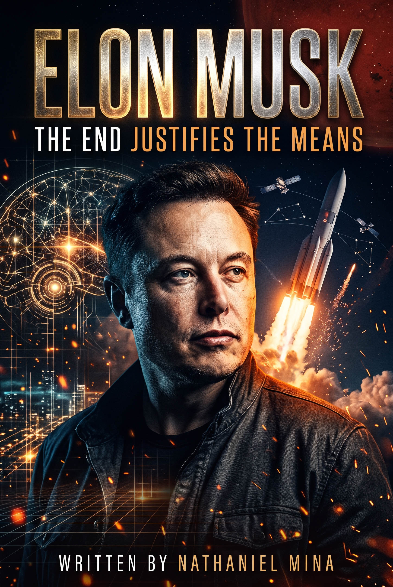

# ELON MUSK: The End Justifies the Means

> *"Physics is the law; everything else is a recommendation."*  
> **By Nathaniel Mina (The Author)**

<p align="center">
  
</p>

A full-length, dark-comedy satirical mock-autobiography and interactive digital reading experience chronicling the life, existential crucibles, high-stakes gambles, personal feuds, and megalomaniacal philosophy of the world's most polarizing techno-autocrat.

---

## 📖 Book Description

Written by **Nathaniel Mina (The Author)** from the first-person perspective of a man who views his own consciousness as an optimized operating system and human biology as a bloated legacy codebase, **ELON MUSK: The End Justifies the Means** is an unabridged, darkly comedic deep-dive into the mythos of modern techno-capitalism.

Every chapter is an expansive 10+ page narrative exploring:
- Surviving schoolyard violence in Pretoria by "garbage-collecting trauma"
- Dropping out of a Stanford PhD after forty-eight hours
- Coding Zip2 on futons under server desks and showering at the Palo Alto YMCA
- Crashing an uninsured $1,000,000 McLaren F1 with Peter Thiel in the passenger seat
- Getting spit on by Russian generals in Moscow while trying to buy surplus ICBMs
- Surviving three consecutive rocket explosions on Kwajalein Atoll and near-bankruptcy on Christmas Eve 2008
- Vertical ocean landings on autonomous drone ships and catching Super Heavy with mechanical chopsticks (Mechazilla)
- Liquidating over **$76,500,000 in domestic settlements** to seed the future Martian workforce (featuring an official high-contrast Forensic Audit Ledger JPG)
- Sleeping on the Fremont factory floor during Model 3 "Production Hell" and battling the SEC with red satin "Short Shorts"
- Entering Twitter HQ carrying a porcelain sink, firing 80% of staff over a weekend, telling advertisers to "Go f*** yourself", and challenging Mark Zuckerberg to a Colosseum cage match
- Suring Sam Altman over OpenAI's conversion to a closed-source Microsoft coupon and building the 100,000 H100 GPU "Colossus" cluster in Memphis in 122 days
- Nuking the Martian poles to terraform the Red Planet and enforcing an 84-hour colony shift
- Chainsawing federal bureaucracy through the Department of Government Efficiency (DOGE)

---

## 📚 Complete Book Architecture (19 Sections)

### Part I: Foundations & Early Exothermic Calibrations
- **Section 01 · Title Page & Official Book Cover** (p. 1)
- **Section 02 · Table of Contents & Master Manuscript Index** (p. 3)  
  *Classic book layout detailing all parts, chapters, subheadings, and page ranges.*
- **Section 03 · Preface: The Biographer's Hazard** (p. 5)  
  *By Nathaniel Mina (The Author) on surviving the editorial velocity of a techno-autocrat.*
- **Section 04 · Introduction: User Manual for My Operating System** (p. 9)  
  *By Elon Musk on deleting empathy subroutines to free up cognitive RAM.*
- **Section 05 · Chapter 1: First Principles of a Cosmic Entity** (pp. 13–24)  
  *Pretoria simulation benchmark, Blastar liquidity event, Queen's University futon, sawmill boiler sludge, Stanford 48-hour PhD drop, YMCA shower protocols, and the fundamental First-Principles equation.*
- **Section 06 · Chapter 2: Silicon Valley Bloodbath & The PayPal Coup** (pp. 25–36)  
  *X.com origins, uninsured McLaren F1 crash with Peter Thiel, Confinity merger war, Levchin Windows NT holy war, honeymoon flight coup, $165M eBay liquidation, and Thiel's seasteading delusions.*
- **Section 07 · Chapter 3: Kwajalein Atoll & The $100 Million Gamble** (pp. 37–48)  
  *Moscow ICBM spit negotiations, raw aluminum rocketry, Kwajalein coral island exile, Flights 1–3 fiery disintegrations, 2008 Christmas Eve bankruptcy brink, Flight 4 orbit, and the $1.6B NASA contract.*

### Part II: Industrial Scaling & The Cost of Velocity
- **Section 08 · Chapter 4: The Gospel of Unplanned Rapid Disassembly** (pp. 49–60)  
  *Autonomous sea landings on drone ships, Boca Chica stainless steel welding tents, SN8–SN11 belly-flop explosions, Mechazilla chopstick booster catches, and mocking Jeff Bezos's orbital lawsuits.*
- **Section 09 · Chapter 5: The Liquidation of Domestic Capital** (pp. 61–74)  
  *Demographic collapse mitigation, Justine Wilson $20M settlement, Talulah Riley dual-pass simulation ($20.2M), Grimes Rococo Basilisk courtship, alphanumeric offspring, family court extortion, and the **$76.5M Forensic Settlement Ledger (Embedded High-Contrast JPG Diagram)**.*
- **Section 10 · Chapter 6: The Math Doesn't Lie (Unless It's Inefficient)** (pp. 75–86)  
  *Schedule Compression dynamics, negative aerodynamic drag, deleting 400 assembly robots, Gigapress stamping, and terminating academic consultants citing the Second Law of Thermodynamics.*
- **Section 11 · Chapter 7: The Island Protocol** (pp. 87–98)  
  *Little Saint James off-grid capital briefings with Jeffrey Epstein, subterranean leverage, sovereign wealth networks, and unmasking legacy billionaire philanthropy as tax-sheltered guilt.*

### Part III: Digital Panopticon, AI & The Martian Imperative
- **Section 12 · Chapter 8: The Fremont Production Purgatory** (pp. 99–112)  
  *Model 3 factory floor sleeping, general assembly tents (GA4), parking lot firings, the $420 funding secured tweet storm, SEC warfare, short seller decimation, and red satin Short Shorts.*
- **Section 13 · Chapter 9: The $44 Billion Sinkhole & The Digital Panopticon** (pp. 113–126)  
  *Porcelain sink entrance at Twitter HQ, firing Agrawal and Gadde on minute one, print-out code reviews, firing 80% of staff, renaming to X, DealBook advertiser warfare, and the Colosseum cage match challenge to Mark Zuckerberg.*
- **Section 14 · Chapter 10: The Meatware Upgrade (Neuralink & The Borg Fleet)** (pp. 127–140)  
  *Cortical bandwidth limitations, surgical robot threads, primate mind-Pong, human Telepathy trials, the Sam Altman betrayal feud, and constructing the 100,000 H100 Colossus cluster in Memphis.*
- **Section 15 · Chapter 11: The Red Planet Manifest Destiny** (pp. 141–154)  
  *Fermi Paradox resolution, Earth single-point failure liabilities, terraforming poles with thermonuclear warheads, 1,000-Starship armada, Martian direct democracy, and the mandatory 84-hour colony shift.*
- **Section 16 · Chapter 12: The Autonomous Swarm & The End of Labor** (pp. 155–168)  
  *LiDAR bans, pure vision FSD architecture, Cybercab un-crewed reveal, Optimus humanoid assembly fleets, elimination of manual labor, and legacy automakers as walking corpses.*
- **Section 17 · Chapter 13: The Apotheosis of Capital** (pp. 169–182)  
  *Richest biological entity in recorded history, Delaware Chancery Court $56B compensation voiding, Texas corporate relocation, DOGE bureaucratic reduction chainsaw, and the final cosmological verdict.*

### Part IV: Appendices & Author Bio
- **Section 18 · Appendix: Canonical Quotations & Maxim Ledger** (pp. 183–188)  
  *Comprehensive verified keynotes, aphorisms, regulatory defiance, and Martian proclamations.*
- **Section 19 · About the Author: Nathaniel Mina** (pp. 189–190)  
  *Biographical background of Nathaniel Mina (The Author) embedded in the Musk operational orbit.*

---

## ⚡ Interactive Web Experience Features

- **13 High-Contrast Neo-Noir Chapter Illustrations**: Every single chapter features a custom 16:9 graphic novel chiaroscuro plate depicting iconic scenes (Pretoria Blastar coding, McLaren wreckage, Kwajalein night explosions, Starship RUDs, Twitter sink entrance, Neuralink surgery, Mars armada, Optimus legions, and the D.O.G.E. chainsaw throne) with an interactive full-resolution lightbox viewer.
- **Front Matter Table of Contents**: Dedicated interior index immediately following Page 1, with direct jump links and estimated page markers.
- **Embedded Forensic JPG Diagram**: Chapter 5 renders an authentic high-contrast corporate forensic audit ledger JPG with embedded zoom and native inclusion in Word (`.docx`) exports.
- **Continuous Auto-Advancing TTS Narration**: Listen to chapters synthesized in Elon's voice with seamless chapter-to-chapter auto-progression and adjustable playback speed controls (`1x`, `1.25x`, `1.5x`, `2x`).
- **SpaceX Launch Soundscape Controller**: Persistent ambient audio engine generating real-time rocket thruster hum and sub-bass rumble via the Web Audio API.
- **Elon AI Neural Chat**: Real-time conversational AI simulation of Elon Musk's unfiltered persona, answering inquiries with trademark humor, first-principles logic, and megalomaniacal swagger.
- **Famous Quotes & Megalomaniacal Dispatches**: Searchable archive of quotes with category filters, a "Random Elon Oracle" generator, and voice synthesis.
- **Comprehensive Landmark Timeline (1971–2026+)**: Interactive chronology tracking 18 historic milestones with category filtering and tactical impact assessments.
- **Multi-Format Manuscript Export**: Instant one-click download of the complete 160+ page book in formatted **Microsoft Word (.docx)** (with high-res cover art, all 13 embedded chapter noir illustrations, and the Chapter 5 forensic audit diagram), **Markdown (.md)**, or **Plain Text (.txt)**.
- **Relative Scroll Depth Tracker**: Real-time progress bar calibrated directly against active chapter text.

---

## 🚀 Getting Started Locally

### Prerequisites
- Node.js (v18 or higher)
- npm

### Installation
```bash
# Clone the repository
git clone https://github.com/your-username/elon-musk-parody-autobiography.git

# Navigate into the project folder
cd elon-musk-parody-autobiography

# Install dependencies
npm install

# Start development server
npm run dev
```

Visit `http://localhost:3000` in your browser.

---

## 🌐 Deployment

### Deploying to Render.com
1. Connect your GitHub repository to [Render](https://render.com).
2. Create a new **Web Service**.
3. Set the **Build Command** to:
   ```bash
   npm run build
   ```
4. Set the **Start Command** to:
   ```bash
   npm start
   ```
5. Add your `GEMINI_API_KEY` in Render Environment Variables for AI neural chat and voice narration features.

---

## ⚖️ Disclaimer
*This project is an unauthorized work of satire and parody. All public personas, entities, and biographical incidents are dramatized for comedic, critical, and entertainment purposes. All rights reserved across three dimensions and Mars orbit.*
